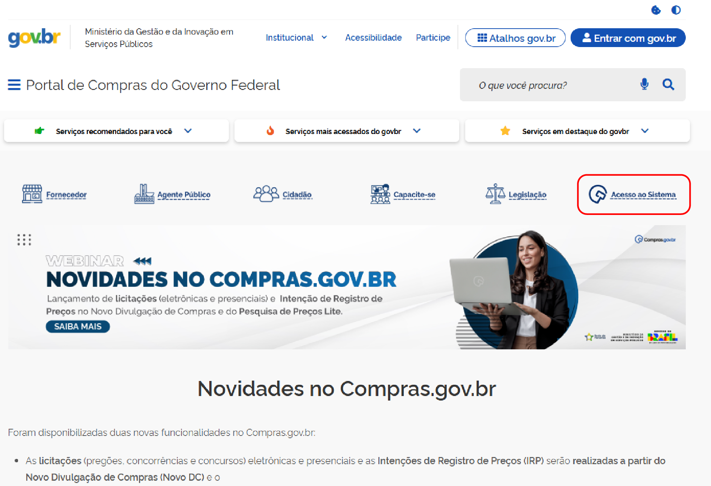
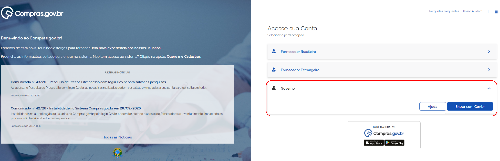
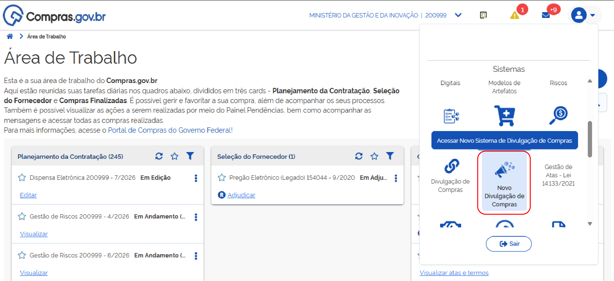

 Tamanho do texto:
 <button onclick="diminuirFonte()" title="Diminuir texto" style="padding: 6px 12px; font-weight: bold; cursor: pointer; border: 1px solid #ccc; border-radius: 4px; background: #f8f9fa;">A-</button>
 <button onclick="resetarFonte()" title="Tamanho normal" style="padding: 6px 12px; font-weight: bold; cursor: pointer; border: 1px solid #ccc; border-radius: 4px; background: #f8f9fa;">A</button>
 <button onclick="aumentarFonte()" title="Aumentar texto" style="padding: 6px 12px; font-weight: bold; cursor: pointer; border: 1px solid #ccc; border-radius: 4px; background: #f8f9fa;">A+</button>
 
<button onclick="window.print()" style="background-color: #0056b3; color: white; padding: 6px 16px; border: none; border-radius: 5px; font-size: 14px; cursor: pointer; box-shadow: 0 2px 4px rgba(0,0,0,0.2); margin-left: 10px;">
 🖨️ Imprimir ou baixar esta página
 </button>

# 1. ACESSAR O COMPRAS.GOV.BR

Acesse o sistema com o perfil Governo e localize o módulo Novo Divulgação de Compras.

**Passo 1:** No Portal de Compras do Governo Federal, selecione “Acesso ao Sistema”. 

**Passo 2:** Na página de entrada, escolha o perfil **Governo** e clique em “Entrar com Gov.br”. Faça o login com seu CPF e senha cadastrados no Gov.br.

**Passo 3:** Na página inicial do Novo DC, abra o menu de sistemas no canto superior direito e clique em **Novo Divulgação de Compras**.

 

 <button onclick="window.print()" style="background-color: #0056b3; color: white; padding: 10px 20px; border: none; border-radius: 5px; font-size: 16px; cursor: pointer; box-shadow: 0 2px 4px rgba(0,0,0,0.2);">
 🖨️ Imprimir ou baixar esta página
 </button>

