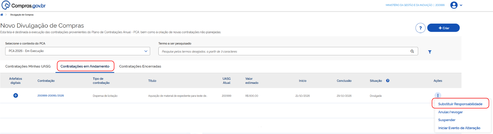
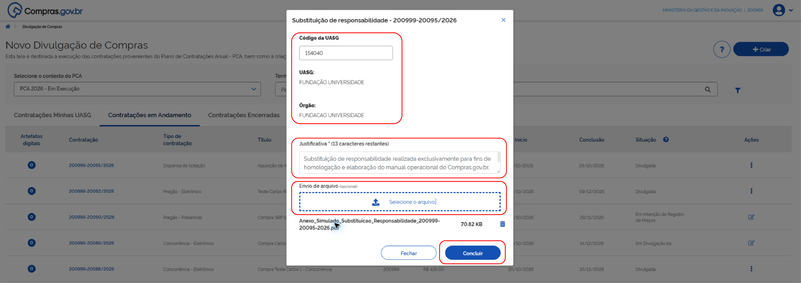
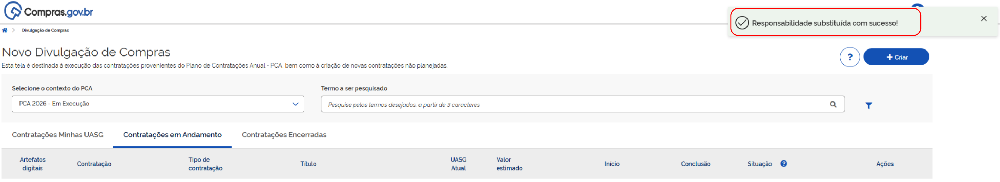
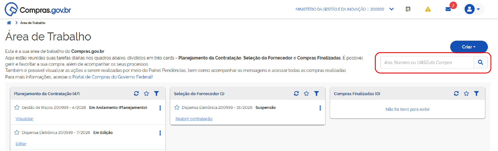
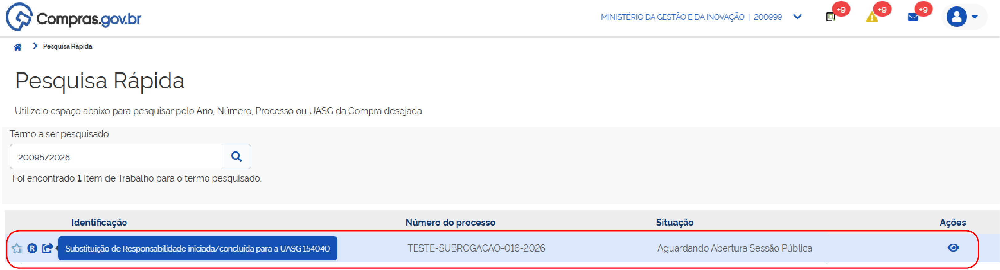
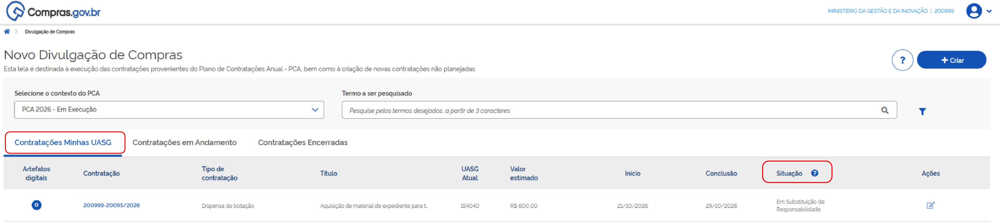

 Tamanho do texto:
 <button onclick="diminuirFonte()" title="Diminuir texto" style="padding: 6px 12px; font-weight: bold; cursor: pointer; border: 1px solid #ccc; border-radius: 4px; background: #f8f9fa;">A-</button>
 <button onclick="resetarFonte()" title="Tamanho normal" style="padding: 6px 12px; font-weight: bold; cursor: pointer; border: 1px solid #ccc; border-radius: 4px; background: #f8f9fa;">A</button>
 <button onclick="aumentarFonte()" title="Aumentar texto" style="padding: 6px 12px; font-weight: bold; cursor: pointer; border: 1px solid #ccc; border-radius: 4px; background: #f8f9fa;">A+</button>
 
<button onclick="window.print()" style="background-color: #0056b3; color: white; padding: 6px 16px; border: none; border-radius: 5px; font-size: 14px; cursor: pointer; box-shadow: 0 2px 4px rgba(0,0,0,0.2); margin-left: 10px;">
 🖨️ Imprimir ou baixar esta página
 </button>

# 2. SOLICITAR A SUBSTITUIÇÃO DE RESPONSIBILIDADE

!!! note "Nota"
    A UASG de origem inicia a operação e indica a UASG que passará a ser responsável pela gestão da contratação.

**Passo 4:** Na UASG de origem, clique na aba **Contratações em Andamento**, identifique a contratação e, no menu de ações (três pontos), selecione **Substituir Responsabilidade**.

**Passo 5:** Informe o **Código da UASG de destino**, confirme a identificação da unidade, preencha a **Justificativa** obrigatória e, se necessário, anexe documento de suporte. Depois, clique em **Concluir**.

**Passo 6:** O sistema apresenta a mensagem *“Responsabilidade substituída com sucesso!”*.

!!! warning "Atenção"
    Os passos acima registram a solicitação de substituição de responsabilidade. A efetivação depende da análise pela UASG destinatária.

**Passo 7:** Na Pesquisa Rápida, insira os dados da contratação ou UASGs e clique na lupa.

**Passo 8:** Localize a contratação e verifique o indicador de substituição de responsabilidade.

**Passo 9:** Na aba **Contratações Minhas UASG**, verifique o campo **“Situação”**, que identifica a etapa em que está a solicitação de análise pela UASG destinatária.

 

 <button onclick="window.print()" style="background-color: #0056b3; color: white; padding: 10px 20px; border: none; border-radius: 5px; font-size: 16px; cursor: pointer; box-shadow: 0 2px 4px rgba(0,0,0,0.2);">
 🖨️ Imprimir ou baixar esta página
 </button>

