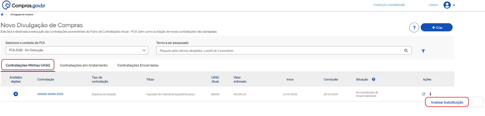
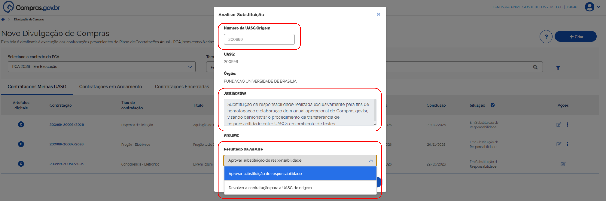
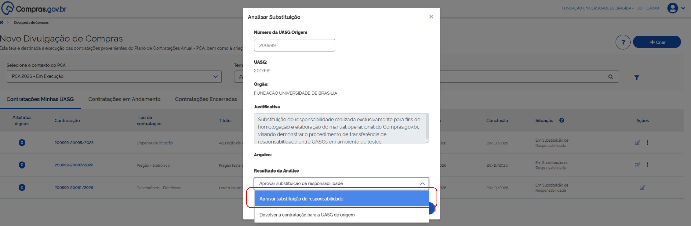
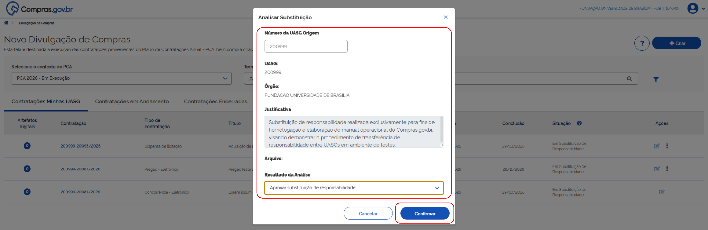
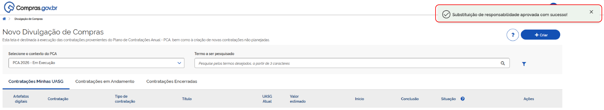

 Tamanho do texto:
 <button onclick="diminuirFonte()" title="Diminuir texto" style="padding: 6px 12px; font-weight: bold; cursor: pointer; border: 1px solid #ccc; border-radius: 4px; background: #f8f9fa;">A-</button>
 <button onclick="resetarFonte()" title="Tamanho normal" style="padding: 6px 12px; font-weight: bold; cursor: pointer; border: 1px solid #ccc; border-radius: 4px; background: #f8f9fa;">A</button>
 <button onclick="aumentarFonte()" title="Aumentar texto" style="padding: 6px 12px; font-weight: bold; cursor: pointer; border: 1px solid #ccc; border-radius: 4px; background: #f8f9fa;">A+</button>
 
<button onclick="window.print()" style="background-color: #0056b3; color: white; padding: 6px 16px; border: none; border-radius: 5px; font-size: 14px; cursor: pointer; box-shadow: 0 2px 4px rgba(0,0,0,0.2); margin-left: 10px;">
 🖨️ Imprimir ou baixar esta página
 </button>

# 3. ANALISAR E APROVAR A SUBSTITUIÇÃO

A UASG destinatária deve analisar a solicitação.

Para analisar a solicitação de substituição de responsabilidades, o servidor da UASG destinatária precisa acessar o módulo Novo Divulgação de Compras (Novo DC).

**Passo 10:** Na aba **Contratações Minhas UASG**, localize a contratação desejada e, no menu de ações, selecione **Analisar Substituição**.

**Passo 11:** Na janela Analisar Substituição, confira o *"Número da UASG de origem"* e a *"Justificativa"*. Em Resultado da Análise, há as opções: **Aprovar substituição de responsabilidade** ou **Devolver a contratação para a UASG de origem**.

!!! note "Nota"
    Neste tutorial vamos ilustrar os passos necessários quando a solicitação de substituição de responsabilidades é aprovada.

**Passo 12:** Clique em **Aprovar substituição de responsabilidade**.

**Passo 13:** Verifique todas as informações apresentadas na tela e clique em **Confirmar** para registrar a decisão da UASG destinatária.

**Passo 14:** A mensagem *“Substituição de responsabilidade aprovada com sucesso!”* confirma a aprovação pela UASG destinatária.

!!! warning "Atenção"
    Após a aprovação, a UASG destinatária deve prosseguir com as ações necessárias para a continuidade do processo de contratação. E, se necessário, designar formalmente agentes de contratação, pregoeiros ou outros responsáveis para a continuidade processual.

 

 <button onclick="window.print()" style="background-color: #0056b3; color: white; padding: 10px 20px; border: none; border-radius: 5px; font-size: 16px; cursor: pointer; box-shadow: 0 2px 4px rgba(0,0,0,0.2);">
 🖨️ Imprimir ou baixar esta página
 </button>

