

 Tamanho do texto:
 <button onclick="diminuirFonte()" title="Diminuir texto" style="padding: 6px 12px; font-weight: bold; cursor: pointer; border: 1px solid #ccc; border-radius: 4px; background: #f8f9fa;">A-</button>
 <button onclick="resetarFonte()" title="Tamanho normal" style="padding: 6px 12px; font-weight: bold; cursor: pointer; border: 1px solid #ccc; border-radius: 4px; background: #f8f9fa;">A</button>
 <button onclick="aumentarFonte()" title="Aumentar texto" style="padding: 6px 12px; font-weight: bold; cursor: pointer; border: 1px solid #ccc; border-radius: 4px; background: #f8f9fa;">A+</button>
 
<button onclick="window.print()" style="background-color: #0056b3; color: white; padding: 6px 16px; border: none; border-radius: 5px; font-size: 14px; cursor: pointer; box-shadow: 0 2px 4px rgba(0,0,0,0.2); margin-left: 10px;">
 🖨️ Imprimir ou baixar esta página
 </button>

PÚBLICO-ALVO: AGENTES DE CONTRATAÇÃO E USUÁRIOS GOVERNO AUTORIZADOS

# Substituição de Responsabilidade entre UASGs no Novo Divulgação de Compras (Novo DC)

A substituição de responsabilidade modifica a UASG que responde pela continuidade de uma contratação no Novo Divulgação de Compras (Novo DC).

!!! note "Nota"
    A operação não cria nova contratação: mantém sua identidade e preserva os registros de atos anteriores, enquanto transfere a responsabilidade pelos atos subsequentes à UASG destinatária após a aprovação.

**Duas Etapas para Efetivação** 
A UASG de origem solicita a substituição e a UASG destinatária analisa a solicitação. A efetivação demonstrada neste manual depende da aprovação pela destinatária.

**note "Leitura das Telas** 
As imagens são exemplos demonstrativos. Os dados exibidos nas capturas contextualizam o preenchimento, sem constituir exigência de um número específico de contratação.

 

# 1. ACESSAR O COMPRAS.GOV.BR

Acesse o sistema com o perfil Governo e localize o módulo Novo Divulgação de Compras.

**Passo 1:** No Portal de Compras do Governo Federal, selecione “Acesso ao Sistema”. 

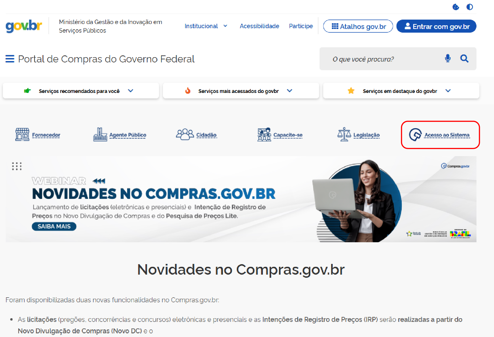

**Passo 2:** Na página de entrada, escolha o perfil **Governo** e clique em “Entrar com Gov.br”. Faça o login com seu CPF e senha cadastrados no Gov.br.

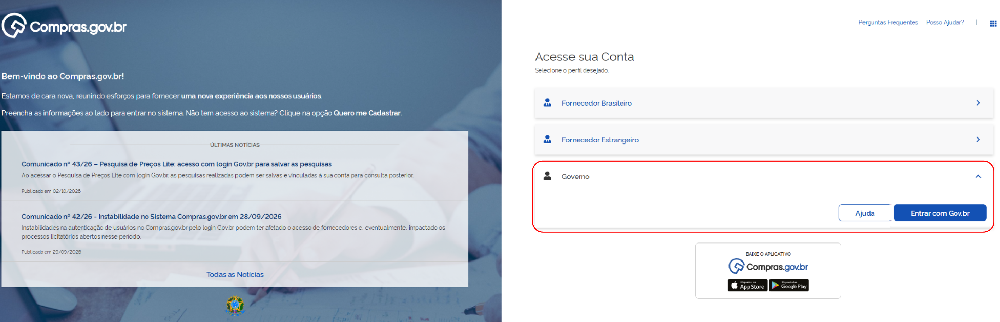

**Passo 3:** Na página inicial do Novo DC, abra o menu de sistemas no canto superior direito e clique em **Novo Divulgação de Compras**.

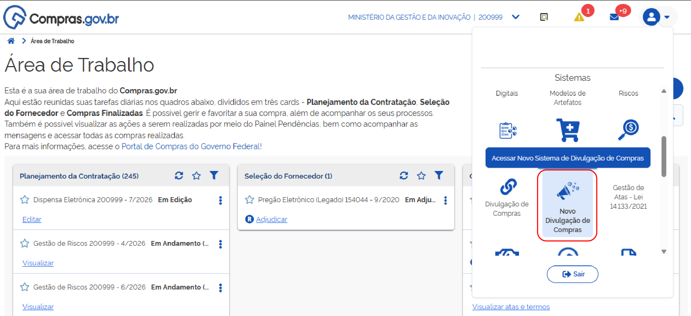

 

# 2. SOLICITAR A SUBSTITUIÇÃO DE RESPONSIBILIDADE

!!! note "Nota"
    A UASG de origem inicia a operação e indica a UASG que passará a ser responsável pela gestão da contratação.

**Passo 4:** Na UASG de origem, clique na aba **Contratações em Andamento**, identifique a contratação e, no menu de ações (três pontos), selecione **Substituir Responsabilidade**.

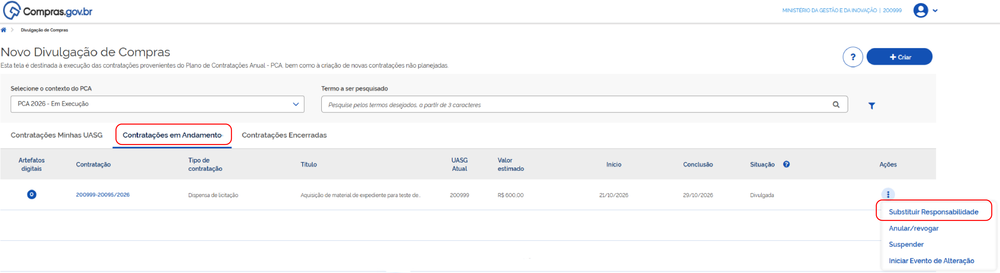

**Passo 5:** Informe o **Código da UASG de destino**, confirme a identificação da unidade, preencha a **Justificativa** obrigatória e, se necessário, anexe documento de suporte. Depois, clique em **Concluir**.

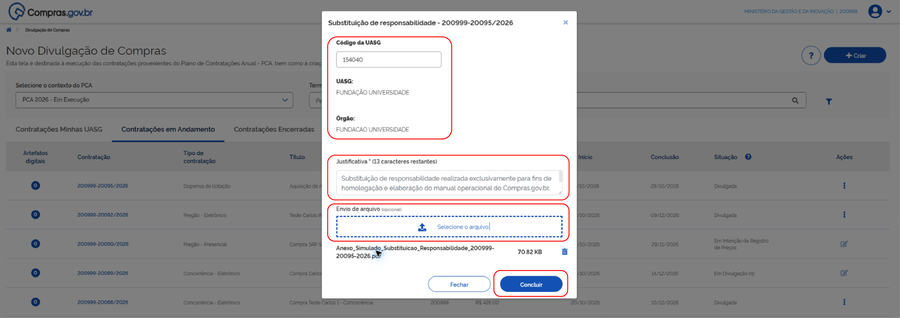

**Passo 6:** O sistema apresenta a mensagem *“Responsabilidade substituída com sucesso!”*.

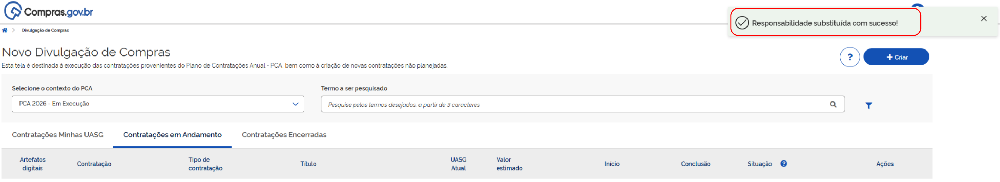

!!! warning "Atenção"
    Os passos acima registram a solicitação de substituição de responsabilidade. A efetivação depende da análise pela UASG destinatária.

**Passo 7:** Na Pesquisa Rápida, insira os dados da contratação ou UASGs e clique na lupa.

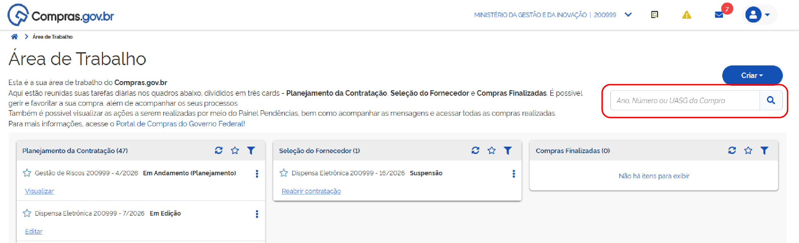

**Passo 8:** Localize a contratação e verifique o indicador de substituição de responsabilidade.

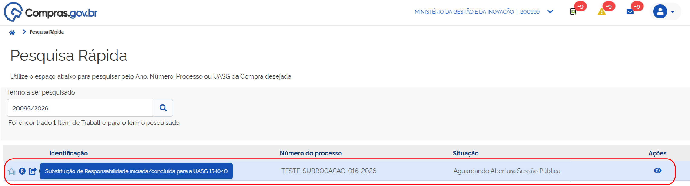

**Passo 9:** Na aba **Contratações Minhas UASG**, verifique o campo **“Situação”**, que identifica a etapa em que está a solicitação de análise pela UASG destinatária.

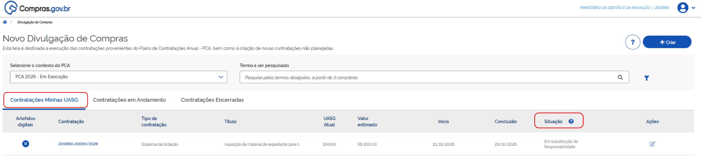

 

# 3. ANALISAR E APROVAR A SUBSTITUIÇÃO

A UASG destinatária deve analisar a solicitação.

Para analisar a solicitação de substituição de responsabilidades, o servidor da UASG destinatária precisa acessar o módulo Novo Divulgação de Compras (Novo DC).

**Passo 10:** Na aba **Contratações Minhas UASG**, localize a contratação desejada e, no menu de ações, selecione **Analisar Substituição**.

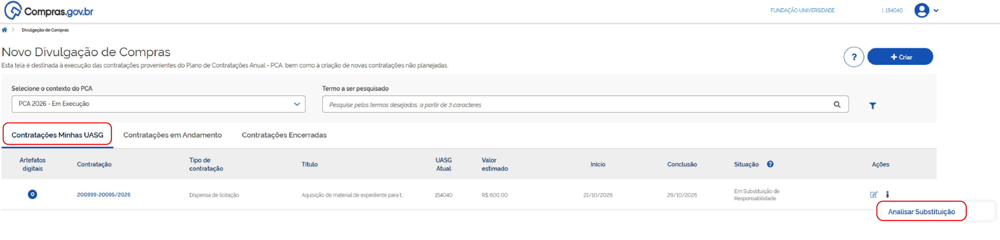

**Passo 11:** Na janela Analisar Substituição, confira o *"Número da UASG de origem"* e a *"Justificativa"*. Em Resultado da Análise, há as opções: **Aprovar substituição de responsabilidade** ou **Devolver a contratação para a UASG de origem**.

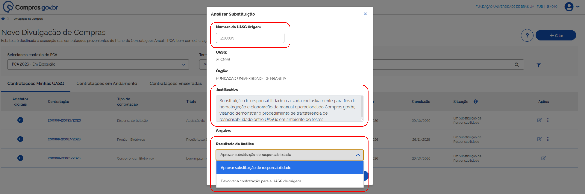

!!! note "Nota"
    Neste tutorial vamos ilustrar os passos necessários quando a solicitação de substituição de responsabilidades é aprovada.

**Passo 12:** Clique em **Aprovar substituição de responsabilidade**.

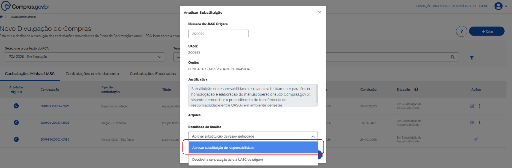

**Passo 13:** Verifique todas as informações apresentadas na tela e clique em **Confirmar** para registrar a decisão da UASG destinatária.

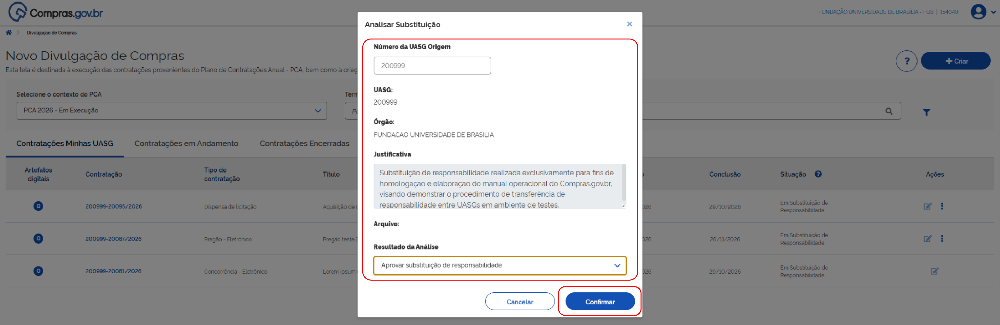

**Passo 14:** A mensagem *“Substituição de responsabilidade aprovada com sucesso!”* confirma a aprovação pela UASG destinatária.

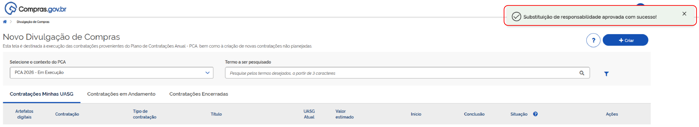

!!! warning "Atenção"
    Após a aprovação, a UASG destinatária deve prosseguir com as ações necessárias para a continuidade do processo de contratação. E, se necessário, designar formalmente agentes de contratação, pregoeiros ou outros responsáveis para a continuidade processual.

 

# 4. CONFERIR A CONTRATAÇÃO NO PNCP

Após a aprovação pela UASG destinatária, a consulta no Portal Nacional de Contratações Públicas (PNCP) permitirá identificar:

* O Órgão/Entidade e Unidade Compradora;
* O Órgão/Entidade e Unidade Compradora sub-rogada.

**Passo 15:** Na consulta ao PNCP, observe que o registro mantém a unidade compradora originária e identifica, em campo próprio, a unidade compradora sub-rogada. A contratação permanece vinculada à sua identificação de origem.

 

# 5. APÓS O ACEITE DA TRANSFERÊNCIA DE RESPONSABILIDADE

A partir do aceite pela UASG destinatária, a gestão operacional e a responsabilidade pelos atos futuros da contratação passam a ser de responsabilidade dos servidores dessa UASG. A numeração original, os documentos, as decisões e o histórico anterior permanecem vinculados ao procedimento de origem.

!!! warning "Atenção"
    A sub-rogação não cria outra contratação nem reinicia o processo. Ela apenas altera a unidade responsável pela continuidade dos atos, preservando a identificação, o histórico e a autoria dos atos anteriores.

---

## Repercussões da substituição de responsabilidade

* **Identificação:** A contratação mantém a referência da UASG de origem e a identificação originária. No PNCP, a unidade sub-rogada é identificada em campo próprio;
* **Responsabilidade operacional:** A partir da sub-rogação, a UASG destinatária (sub-rogada) fica responsável por todas as ações da condução da contratação, inclusive a operação da sala de disputa e as concessões dos perfis de acesso necessários;
* **Atos anteriores:** ETP, TR, edital, decisões, aprovações e demais atos anteriores à sub-rogação permanecem atribuídos aos responsáveis que os praticaram;
* **Atos posteriores:** Novas edições, eventos, documentos e decisões passam a ser executados pela UASG sub-rogada e por seus agentes com atribuição e perfil apropriados;
* **UASG de origem:** Conserva histórico e consulta dos atos anteriores, conforme a regra de acesso definida para a funcionalidade, mas não tem a gestão operacional do sistema;
* **Situação da contratação:** A alteração de responsabilidade não interfere na etapa em que a contratação se encontra, ou seja, todos os prazos legais são mantidos.

---

## Síntese do fluxo

1. UASG de origem pratica os atos iniciais;
2. Solicita substituição;
3. UASG destinatária aprova;
4. Sistema registra a substituição;
5. Contratação conserva identificação e histórico;
6. UASG de origem mantém consulta e autoria dos atos anteriores;
7. UASG sub-rogada assume a gestão e os atos futuros.

 

 <button onclick="window.print()" style="background-color: #0056b3; color: white; padding: 10px 20px; border: none; border-radius: 5px; font-size: 16px; cursor: pointer; box-shadow: 0 2px 4px rgba(0,0,0,0.2);">
 🖨️ Imprimir ou baixar esta página
 </button>

